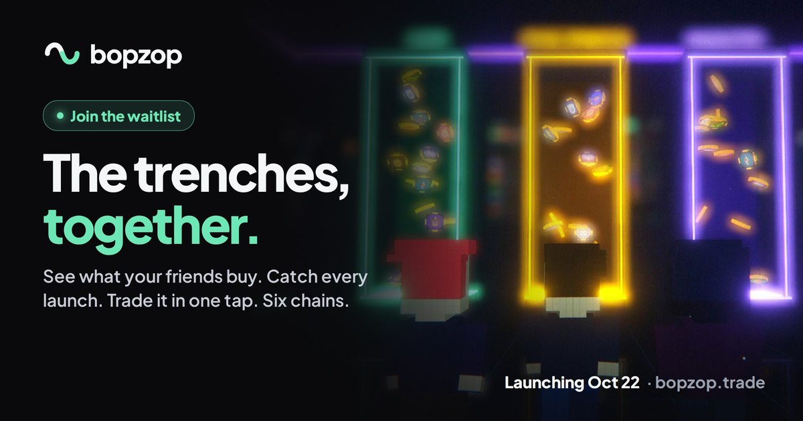

# bopzop open source

[bopzop](https://bopzop.trade) is a social trading app for the trenches: see what your friends buy, catch every launch
the second it drops and trade it in one tap, on six chains. This repo holds two small pieces of it, open for anyone to
read and learn from.

| Package | What it does |
| --- | --- |
| [`pixel-traders`](packages/pixel-traders) | The pixel people of bopzop: deterministic 16×16 traders as tiny SVG strings. [Live demo](https://riaddahhab.github.io/adam/) |
| [`solana-swap-pnl`](packages/solana-swap-pnl) | Realized and unrealized PnL (average cost) of a Solana wallet from its swaps. |

Both have zero dependencies. `npm test` inside a package runs its tests (Node ≥ 22.18).

**The bopzop app itself is closed source.** Only the packages in this repo are published here.

## License

[PolyForm Noncommercial 1.0.0](LICENSE.md): you can read, run and change this code for any noncommercial purpose.
Commercial use is not allowed.
